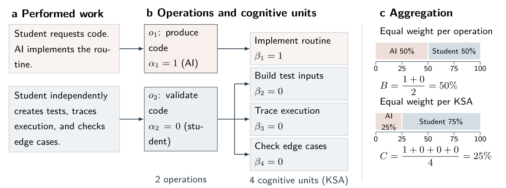
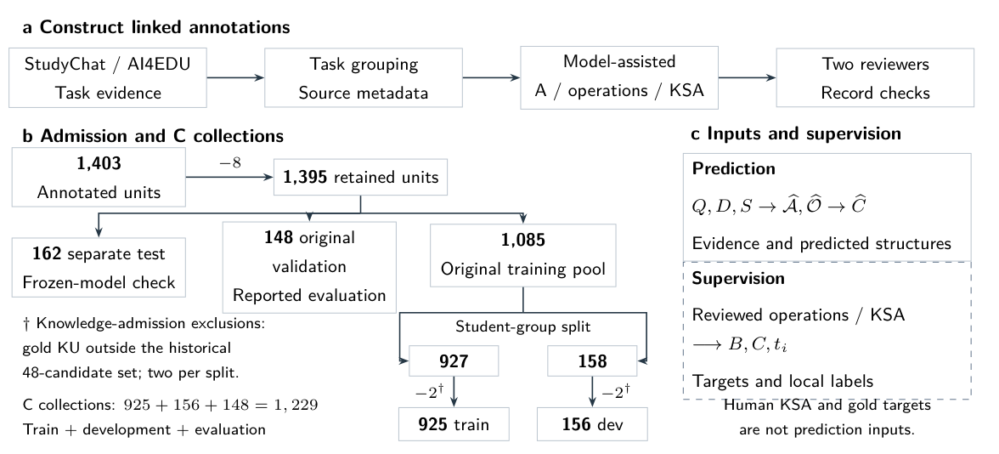
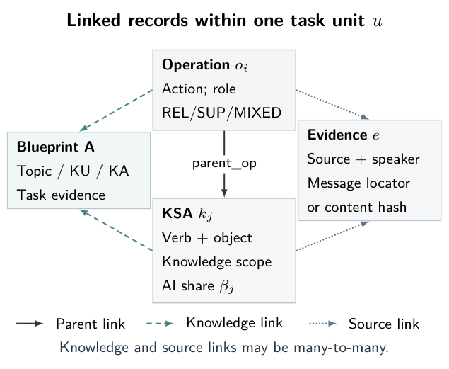
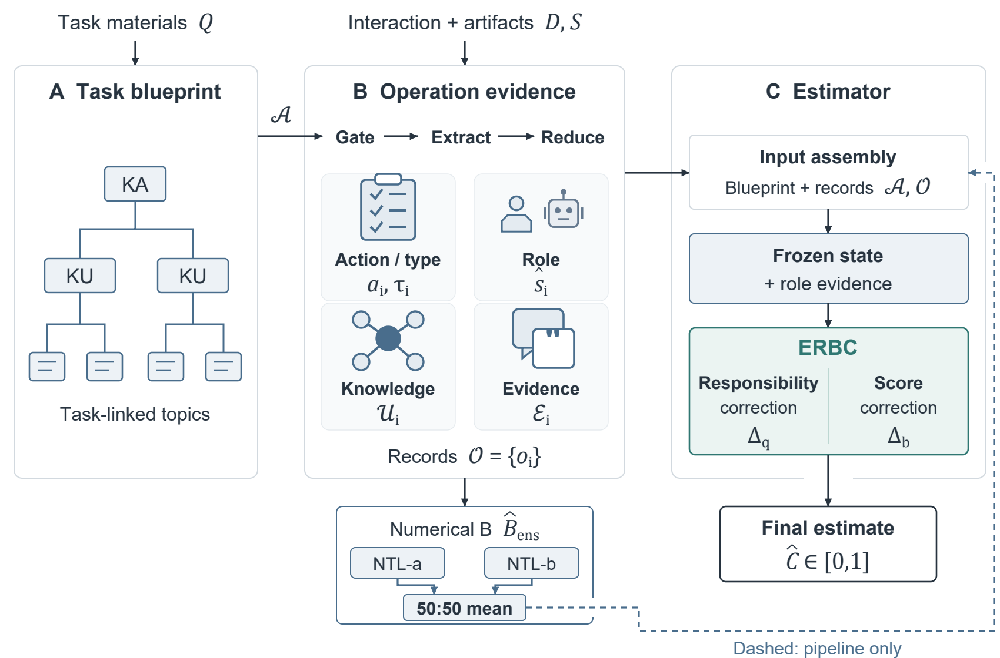
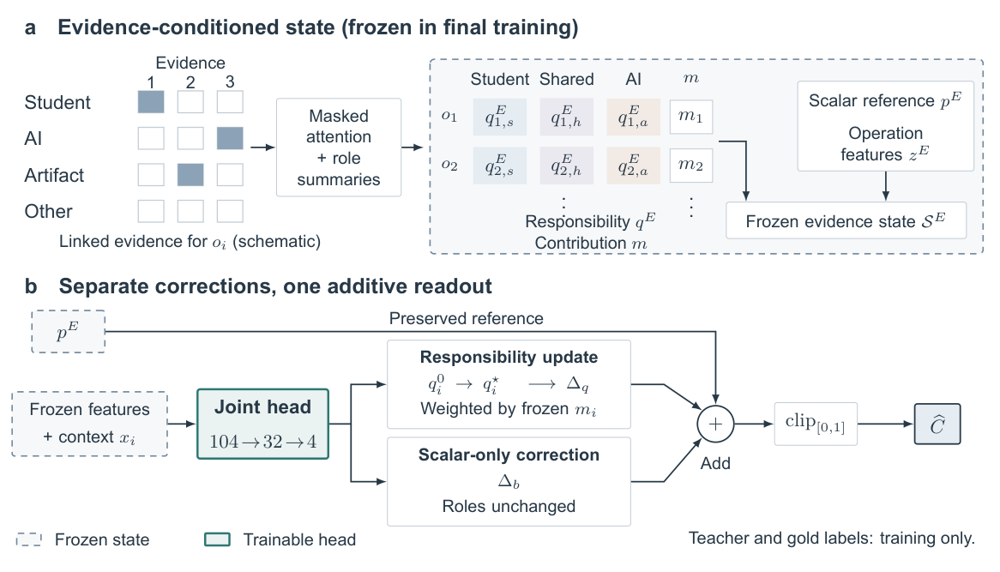
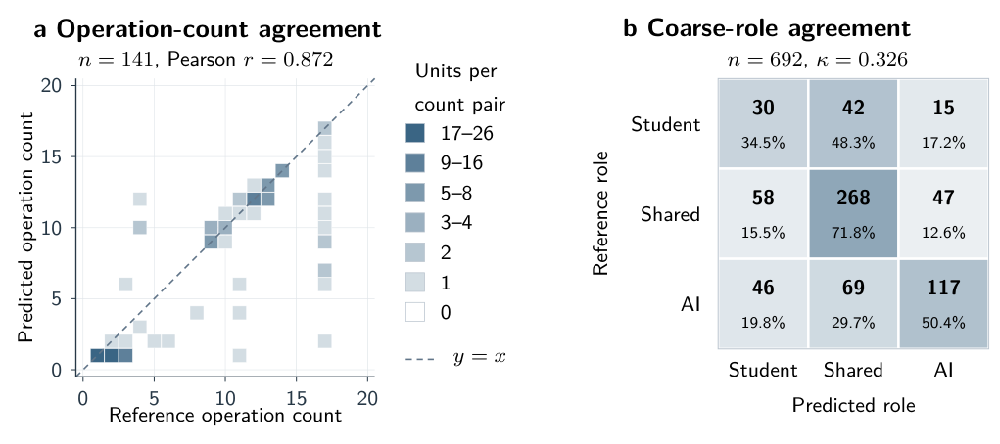

# Paper figures

[Overview](README.md) | [Result tables](RESULT_TABLES.md)

## 1. Operation-level and cognitive-unit aggregation

## 2. Record construction and collection flow

## 3. Linked task records

## 4. A-B-C architecture

## 5. Evidence state and correction branches

## 6. Upstream structure quality

Figure 6 uses 141 available units for operation counts and 692 matched operations for role agreement. The reported kappa is model-reference agreement.
