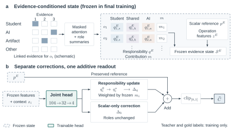

# Method guide

[Back to overview](README.md)

## From task materials to responsibility estimates

| Module | Input | Output |
| :--- | :--- | :--- |
| A · Task blueprint | Task and reference materials | Task requirements linked to the KA–KU–Topic knowledge hierarchy |
| B · Operation evidence | Interactions, artifacts, and blueprint | Consolidated operations retaining roles, knowledge links, and source references |
| C · Final estimator | Structured records, frozen representations, and numerical references | Task-level AI responsibility estimate after responsibility and scalar corrections |

KA and KU denote knowledge areas and knowledge units. A KSA describes an evidenced subactivity as a cognitive verb–knowledge object pair; it is not another level of the knowledge catalog. An operation may contain several KSAs. Links to the blueprint distinguish in-scope and external knowledge. Reviewed KSAs support target construction and local supervision, rather than serving as human-supplied inference inputs.

## Why B and C differ

B measures responsibility at the operation level; C uses cognitive units. In a constructed example, two operations are assigned to AI and student respectively, giving B = 50%. If the AI operation contains one cognitive unit and the student operation contains three, C = 25%. The difference follows from the counting unit, not from a change in the recorded activity.

Structured operation extraction and numerical B prediction are separate interfaces. In the pipeline, each numerical baseline predicts B and supplies that score to its C predictor while retaining the common structured records. ERBC uses the NTL-Ens B estimate.

## Two corrections, one final readout

The frozen evidence state supplies responsibility distributions, contribution weights, a scalar reference, and operation features. The final joint head maps a 104-dimensional input through 32 hidden units to four outputs. Its 3,556 trainable parameters describe the final head, not the entire model.

- **Responsibility correction Δq** updates local responsibility distributions and aggregates their changes using frozen contribution weights.
- **Scalar correction Δb** adjusts the score without changing local responsibility assignments.
- **Readout** preserves the scalar reference, adds both corrections, and clips the result to [0, 1].

Lower score error and more accurate local attribution are different outcomes. The factorial experiment measures the branches' effects on final prediction; pMAE improvement alone does not establish better attribution for every operation.

## Implementation map

See [REPRODUCING.md](REPRODUCING.md) for the module groups and [SOURCE_INDEX.json](SOURCE_INDEX.json) for exact paths. Numerical prediction, local responsibility updates, and scalar correction have separate interfaces.
