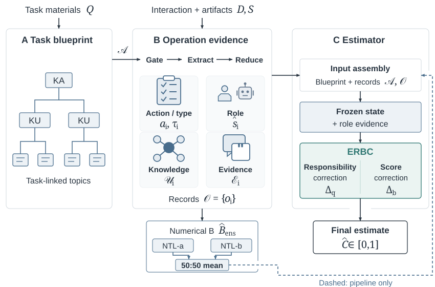

# ERBC

**Evidence-guided Responsibility and Bias Correction**  
Supporting material for *ERBC: Evidence-Guided Estimation of AI Responsibility in Educational Interactions*.

[Method](METHOD_GUIDE.md) · [Results](RESULTS.md) · [Data protocol](DATA_PROTOCOL.md) · [Run the checks](REPRODUCING.md)

## From recorded activity to responsibility estimates

ERBC links task requirements, operation records, and source evidence. Its final estimator combines a frozen evidence state with a responsibility update and a separate scalar correction.



## Paper materials

The repository contains selected implementation modules for data preparation, structured operation extraction, numerical baselines, ERBC, and the factorial correction study. Standalone evaluation and splitting utilities accompany the source modules, together with aggregate results and editable paper figures.

## Quick start

Python 3.10 or later; no third-party packages or GPU required.

```bash
python -m unittest discover -v
python evaluate.py synthetic_scores.json
python verify_files.py
```

The example contains invented records. Its scores are a software check, not experimental evidence.

## Reported results

Final C pMAE in percentage points (lower is better).

| Protocol | NTL-Ens: Overall / CS | ERBC: Overall / CS |
| :--- | ---: | ---: |
| 148-unit C component | 17.5520 / 27.2767 | **15.1457 / 23.0870** |
| 148-unit B-to-C pipeline | 17.1158 / 26.5058 | **14.9537 / 22.7527** |
| 162-unit frozen pipeline check | 17.8538 / 26.5647 | **15.5594 / 22.8563** |

The 148-unit collection was used during development and evaluation. The separately stored 162-unit collection was evaluated with the frozen configuration. CS is a subset of the overall collection. See [Results](RESULTS.md) for the API baseline additions and protocol details.

## Files

| File | Purpose |
| :--- | :--- |
| [Source snapshot](erbc_source_snapshot.zip) | 85 selected implementation modules, indexed in [SOURCE_INDEX.json](SOURCE_INDEX.json) |
| [Figure sources](paper_figure_sources.zip) | Editable bilingual figure sources and vector assets |
| `evaluate.py` | Validate and score a complete evaluation collection |
| `split_recipe.py` | Reconstruct the recorded pre-admission group split from authorized metadata |
| `test_*.py` | Synthetic tests of metric and splitting behavior |
| `synthetic_scores.json` | Small runnable example with expected scores |
| `split_counts.json` | Aggregate admission and collection counts |
| `architecture.svg`, `mechanism.svg` | Editable vector diagrams |
| `SHA256SUMS`, `verify_files.py` | Release-file integrity checks |

## Use and attribution

The standalone original Python utilities at the repository root are licensed under MIT; see [LICENSE](LICENSE). The source archive retains existing attribution and license notices. The root utility license does not replace the terms of third-party components or archived source.
